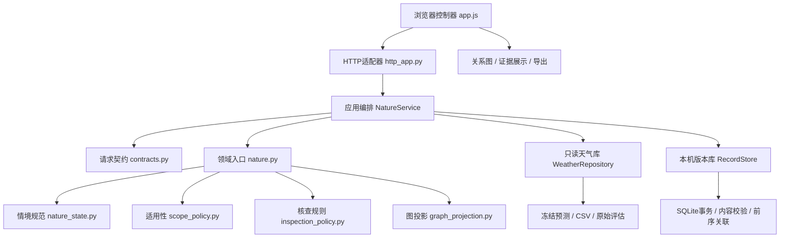

# 茶候 V0.3 本机软件结构

V0.3.1补充不变量：任务的语义去重键只决定同类核查项；模拟完成仅在相关观测、天气范围、规则与证据摘要相同时继承。相关依据改变会重开核查，原版本不改写。

本版定位是“历史天气回放与AI情境核查工作台”。它已经有可运行的交互、明确的领域规则和可持久保存的记录；真实预报服务、农业效益和比赛平台提交各自仍需单独证据。

## 分层与依赖方向

领域规则不调用HTTP、不写数据库、不访问模型API。天气库、版本库由应用服务通过构造参数注入；HTTP只处理传输、路由、错误和诊断。`nature.py`保留原公共入口，调用方不用随内部拆分改变算法接口。领域入口约200行，原情境、规则和图投影分成独立模块。

## 模块职责

| 文件 | 唯一主要职责 | 不承担的职责 |
|---|---|---|
| `nature_server.py` | 命令参数、启动本机服务器 | 算法、文件记录管理 |
| `teaguard/http_app.py` | HTTP、状态码、请求编号、结果诊断 | 选择农业结论 |
| `teaguard/contracts.py` | 请求对象、字段、版本号与布尔类型检查 | 自动修正用户意图 |
| `teaguard/nature_service.py` | 分析、反馈、历史查询用例编排 | 重训、网络数据采集 |
| `teaguard/nature_state.py` | 统一情境、未知项、来源和观测范围 | 根据缺失值猜测实测 |
| `teaguard/scope_policy.py` | 五卡条件匹配与不支持范围 | 损伤或增产预测 |
| `teaguard/inspection_policy.py` | 有依据的核查任务生成 | 剂量控制与自动灌溉 |
| `teaguard/graph_projection.py` | 将既有判断投影为关系图 | 学习因果边权 |
| `teaguard/evidence_catalog.py` | 一次性读取并冻结卡、来源与结构版本 | 每次请求悄悄热更新来源 |
| `teaguard/weather_repository.py` | 校验并读取冻结天气和保存预测 | 模型训练或在线预报 |
| `teaguard/record_store.py` | 事务、内容标识、前序约束、历史读取 | 在浏览器里保存权威记录 |
| `web/api.js` | 超时、错误类别、请求编号；不自动重发POST | 掩盖未知完成状态 |
| `web/graph.js` | 关系图布局、拖动、键盘与触摸交互 | 改写判定数值 |
| `web/views.js` | 证据卡、数据覆盖与回放的展示 | 业务判断与写入 |
| `web/export.js` | 带来源和边界的Markdown/JSON下载 | 编造现场完成事实 |

## 一次操作的生命周期

1. 浏览器将条件标记为待更新，暂停旧结果导出与反馈。
2. 请求契约拒绝未知字段、错误类型和非法版本号。
3. 应用层查找明确的前序版本；找不到则给出404和恢复入口，不静默重置。
4. 读取已校验的冻结天气，运行情境规范、证据条件和核查规则。
5. 根据完整结果生成内容标识，在SQLite事务里检查前序并插入新记录。
6. 返回结果，更新页面；勾选和撤销产生新版本，重试相同反馈复用同一记录。

浏览器同一时刻只处理一个会改变记录的操作。反馈等待期间锁定条件、情境载入、历史选择与导出，防止旧响应覆盖后来输入。超时保留旧记录并提示手动重试。新窗口从服务器读取历史，不依赖localStorage。

## 记录与可复现性

- 版本号由除版本号自身外的完整结果JSON计算SHA-256，取前24个十六进制字符；数据库保存完整SHA-256并逐次校验内容。它是本机完整性检查，不是数字签名或可信时间戳。
- 前序版本必须存在且内容校验有效；数据库外键与事务保证不会留下半写入记录。单实例写入串行化，SQLite负责事务；验证包含16次并发保存。
- 算法摘要包含领域模块、证据卡、来源登记与情境结构摘要。旧引擎记录可查看、导出；继续修改需要明确开始独立分析。
- 固定天气库同时校验CSV、来源、保存预测与评估文件；不只检查CSV。
- HTTP启动时冻结页面资源和源码摘要；修改源码后必须重启相应本机服务。验收比较当前文件、运行服务和浏览器回执。
- `runtime/`保存运行记录与请求诊断；`artifacts/`保存验证产物；二者与固定的`data/`分开。源码包排除本机数据库与请求日志。

## 当前规模的取舍

保持一个本机Python进程、标准库HTTP/SQLite、原生浏览器ES模块，无需Redis、微服务、队列、外部agent或新增模型服务。单人本机规模优先验证职责与故障恢复。暂无公网多用户身份隔离、分布式并发、容量压力、灾备恢复或生产SLA保证。
